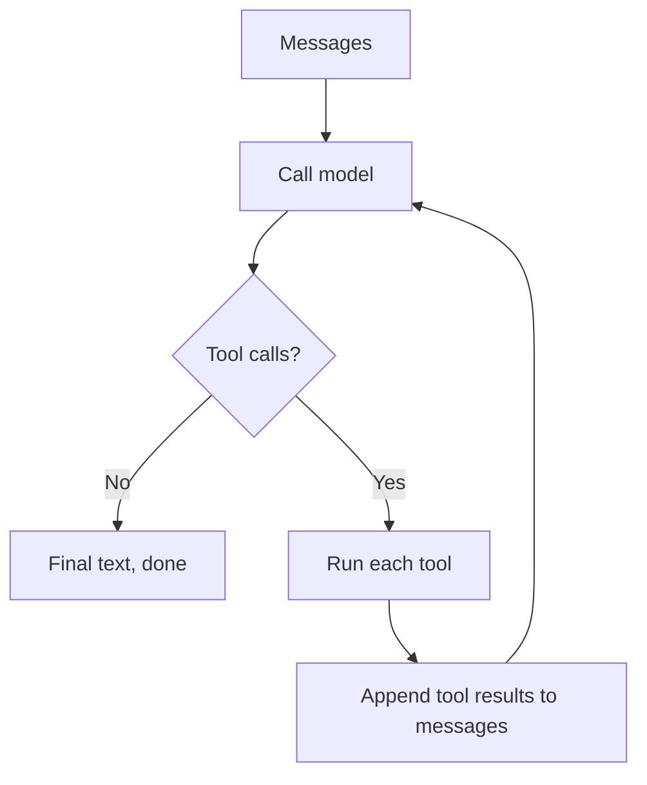
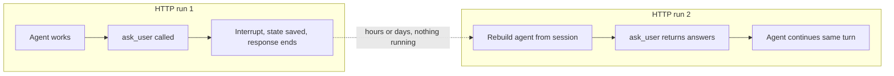
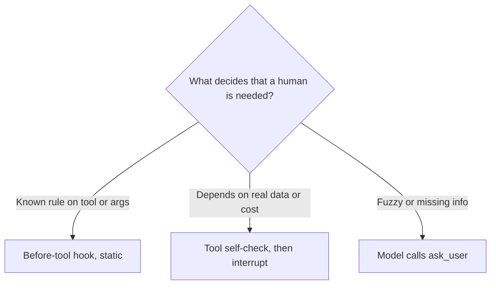
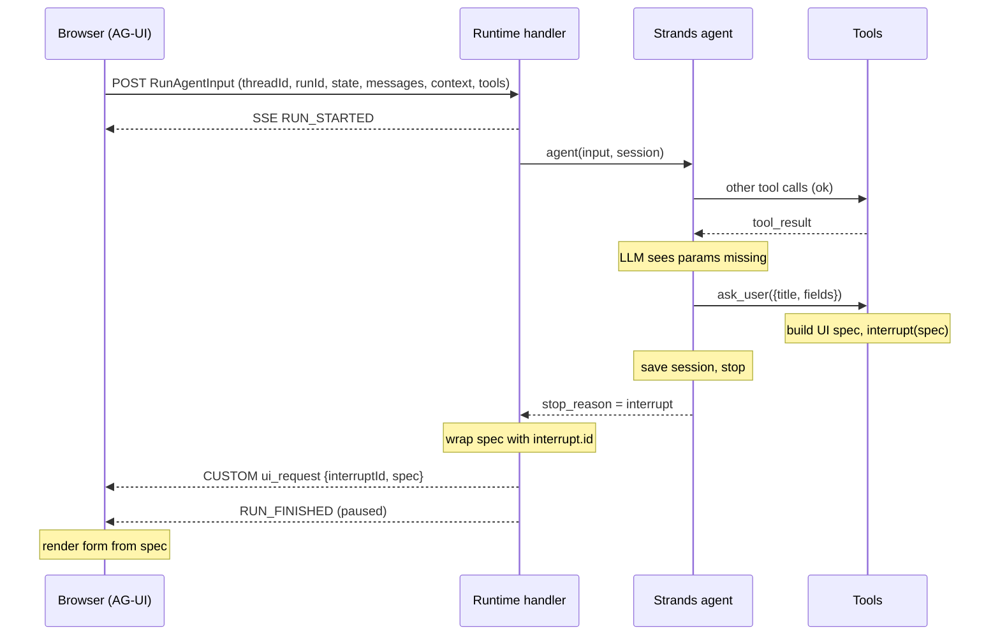
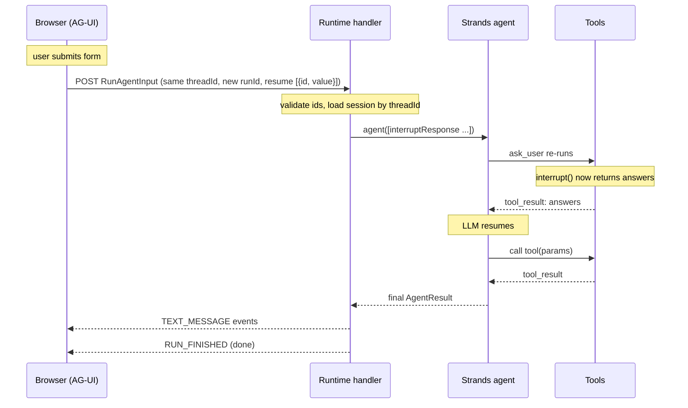
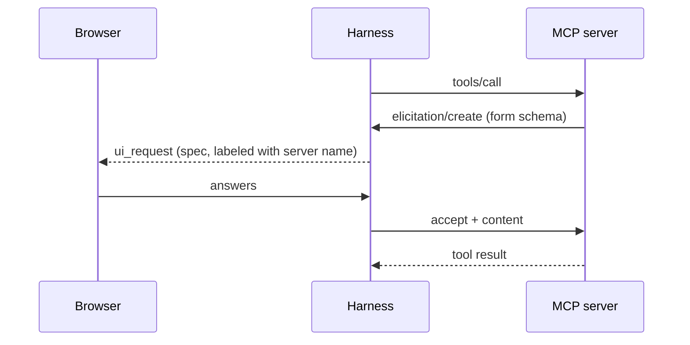

---
aliases:
---
---
# Human-in-the-loop (HITL) and interrupts: a learning and revision guide

Stack discussed: browser client (AG-UI) -> AgentCore Runtime -> Strands agent -> tools and MCP servers.

How to use this guide:
- First read: go in order. Each part builds on the one before it.
- Revision: read Part 1 (one-page summary), Part 17 (self-test) and Part 18 (cheat sheet).
- Things marked "verify" are details that change fast or that I was not able to confirm. Check the current docs before relying on them.

---

## Contents

1. One-page summary
2. Foundations: the model API, the agent loop, tools
3. HITL: what it is and the different ways to do it
4. Interrupts: what they are and why they exist
5. Two meanings of "run" (the most important idea)
6. What triggers an interrupt
7. Strands specifics
8. AG-UI and AgentCore: moving it between browser and agent
9. Sequence diagrams, step by step
10. The `ask_user` tool in detail
11. Building interrupts from scratch (crude implementation)
12. Building hooks from scratch
13. Dynamic cases: the huge-data example
14. Ready-made schemas you can borrow
15. MCP servers that ask the user (elicitation)
16. Production checklist and common mistakes
17. Self-test (with answers)
18. Cheat sheet
19. Things to verify, and what is next

---

## 1. One-page summary

- An LLM API is stateless. You send messages, you get a reply. Everything else is built by you or a framework.
- An agent is a loop around that API: call model, run requested tools, add results, call model again, until the model replies with plain text.
- HITL (human in the loop) is the goal: a human takes part in the agent's flow (approving, giving missing info, reviewing, steering).
- An interrupt is one mechanism for HITL: pause the loop, save state, ask the human, resume later.
- Other HITL mechanisms: a text question, an artifact or doc the user reviews, steering, handoff to a human, after-the-fact review.
- "Run" has two meanings. The HTTP run (a request and its response stream) ends at the interrupt. The agent's turn (what the model sees) does not end. It is frozen and then resumed, so the model continues as if nothing happened.
- Nothing waits on the server while the human thinks. State is saved to durable storage, so the human can answer days later.
- Blocking a tool to wait for the human over HTTP is fragile (dropped connections, recycled containers, timeouts). Ending the run and resuming is the reliable design.
- The mechanism is always deterministic code. What triggers it can be a static rule (a hook), the tool itself (cheap check, then ask), or the model (it calls an `ask_user` tool).
- `ask_user` is a normal tool. The model gives a small input; your code expands it into a UI spec; the tool interrupts with that spec; the frontend renders a form; the answers come back as the tool's result.
- Borrow the form types from MCP elicitation (JSON Schema form fields, with accept, decline and cancel responses) instead of inventing your own.
- MCP servers can ask the user too. That is trickier because the server holds a request open while it waits.

---

## 2. Foundations

### 2.1 The model API is stateless

Every call is independent. You send the full conversation (messages, tool calls, tool results) and get one reply. The model remembers nothing between calls. "Memory" is you re-sending history.

### 2.2 Tool calling

You describe tools (name, description, parameter schema). The model may reply with "call tool X with these arguments" instead of text. You run the tool yourself, then send the result back. The model reads it and continues.

Important rule (Responses API and most others): every tool call in the history must have a matching tool result before the next model call. This is why you can pause only in your own tool-execution step, not between the model's tool call and its result.

### 2.3 The agent loop



Everything in this guide is a variation on this loop. An interrupt is a way to leave the loop at the "Run each tool" step and come back later.

### 2.4 Hooks

Hooks are callbacks that the loop calls at fixed points: before the model call, after the model call, before a tool runs, after a tool runs. Frameworks give them typed event objects and a registry, but underneath it is just "loop calls your functions".

---

## 3. HITL: what it is and the ways to do it

HITL means a human is involved in the agent's flow. It is the goal, not a specific technique.

| Way | What happens | Does the agent turn pause? | Example |
|---|---|---|---|
| Interrupt | Agent freezes mid-tool-call, state saved, human answers, same turn continues | Yes (frozen, then resumed) | "Which city?" form, "Send to 400 customers?" approval |
| Prose question | Model ends its turn with a text question; the answer is a new turn | No (turn ends normally) | "Which date range do you want?" |
| Artifact or doc review | Agent shows a plan or doc and ends the turn; user comments and submits; new run starts | No | "Here is the plan, edit and approve it" |
| Steering | User sends a message while the agent runs; it is injected into the live loop | No (nothing pauses) | "Actually, focus on Europe" mid-run |
| Handoff or escalation | Agent gets stuck and passes the conversation to a human | Ends | Support agent takeover |
| After-the-fact review | A human audits logs or samples results later | No | Quality review |

Rule of thumb:
- Use an interrupt when the agent needs a specific answer to continue exactly where it was.
- Use a normal turn or an artifact when the human is reviewing or reshaping open-ended work.
- Use steering when the human wants to redirect something that is already running.

### Why an interrupt beats a prose question for specific info

- Structured: the frontend gets typed data it can render as a form, not prose to parse.
- Resumes mid-turn: the `ask_user` call stays open, the answers become its result, and the model continues exactly where it stopped. With a prose question, the answer is a new turn and the model must work out what it was doing from history.
- Cleaner history: a tool call with a result, not a question followed by a loose reply.

---

## 4. Interrupts: what they are and why they exist

Definition: an interrupt is a pause point in the agent loop. The loop stops, returns the pending question to the caller, and can be resumed later with the answer.

Why not just block and wait inside the tool?
- The HTTP connection can drop.
- The container or microVM can be recycled.
- Timeouts hit (minutes, not days).
- Scaling: holding a connection per waiting user is wasteful.

So instead: stop, save, return. Resume from saved state when the answer arrives.

Why can IDE agents (like VS Code Copilot) just wait? Everything runs locally in one process, so the tool waits on a button click with no network between agent and user. Server-side agents do not have that luxury.

Note: Strands says interrupts are currently supported in the before-tool-call hook event and inside tools (verify, this may expand).

---

## 5. Two meanings of "run" (most important idea)

| | HTTP run | Agent turn |
|---|---|---|
| What is it | One request and its response stream | The model's work on the user's request |
| At an interrupt | Ends | Frozen, not ended |
| On answer | New request starts | Resumed, same turn continues |
| Who sees it | Frontend | Model |

So: the answer arrives as a new HTTP request (a "new run" in AG-UI terms), but for the model it is one continuous turn that was paused and resumed.



"Nothing waits": between the two runs, no server process is holding anything. Only the saved state exists. That is why the user can take days, like Claude's own interface does.

Requirement: durable session storage (S3, AgentCore Memory, a database), not container memory.

---

## 6. What triggers an interrupt

The mechanism is deterministic code. The trigger can be:

### 6.1 Static trigger (hook with rules)

A before-tool hook checks the tool name, the arguments, the user's role, a risk score, or calls a policy engine or a judge model. If risky, it interrupts. Note: this does not have to be only "tool name equals X". The hook is arbitrary code, so it can inspect arguments and context.

### 6.2 Tool-decided trigger

The tool does a cheap check itself and interrupts from inside. Example: before running a query, estimate the rows. If over a threshold, ask the user. The threshold is a fixed number but the decision is dynamic because it depends on real data.

### 6.3 Model-decided trigger

The model calls an `ask_user` tool when it decides it needs info. Use for fuzzy cases ("this request seems very broad", "a required parameter is missing and cannot be inferred"). Less reliable than 6.1 and 6.2, so use it in addition, not instead.



The trigger is separate from the transport. All three end in the same interrupt, the same spec format, the same frontend and the same resume path.

---

## 7. Strands specifics

(From the docs at the time of writing; verify names against the current version.)

### 7.1 Hook-based interrupt

```python
from strands.hooks import BeforeToolCallEvent, HookProvider, HookRegistry

class ApprovalHook(HookProvider):
    def register_hooks(self, registry: HookRegistry) -> None:
        registry.add_callback(BeforeToolCallEvent, self.check)

    def check(self, event: BeforeToolCallEvent) -> None:
        risk = assess_risk(event.tool_use, event.invocation_state)   # your logic
        if risk.level == "low":
            return
        answer = event.interrupt(
            "approval",
            reason={"tool": event.tool_use["name"],
                    "input": event.tool_use["input"],
                    "why": risk.explanation},
        )
        if answer != "approve":
            event.cancel_tool = "User declined this action."
```

### 7.2 Tool-based interrupt

```python
from strands import tool
from strands.types.tools import ToolContext

@tool(context=True)
def my_tool(tool_context: ToolContext, ...):
    answer = tool_context.interrupt("name", reason={...})
    ...
```

### 7.3 What the caller sees

- `result = agent(prompt)`; if `result.stop_reason == "interrupt"`, then `result.interrupts` is a list of items with `id`, `name`, `reason`.
- To resume, call the agent again with responses:

```python
agent([{"interruptResponse": {"interruptId": i.id, "response": value}}])
```

(Verify the exact payload shape in the current docs.)

### 7.4 Behaviours to remember

- On resume, the hook or tool re-runs from the top. The second time, `interrupt()` returns the saved answer instead of pausing. So code before `interrupt()` must be safe to run twice.
- Interrupt state needs a session manager so it survives between requests.
- Several interrupts can come back at once (parallel tool calls). Respond to all of them together.
- With streaming (`stream_async`), the interrupt is on the final `AgentResult`. One project reported it getting swallowed into a generic error when read the wrong way. Read it from the final result event and emit an explicit event to your client.

---

## 8. AG-UI and AgentCore: moving it between browser and agent

### 8.1 AG-UI input (what the browser sends)

`RunAgentInput` carries:
- `threadId`: the conversation. Reuse it across runs. Map it to the Strands session ID.
- `runId`: one execution. New for every request, including the resume.
- `state`: shared application state.
- `messages`: the conversation messages.
- `tools`: tools defined by the client (optional).
- `context`: extra context items.
- `forwardedProps`: free-form extras (a handy place for resume data if you have no native field).

### 8.2 AG-UI output (events streamed back)

Typical events: `RUN_STARTED`, `TEXT_MESSAGE_*`, `TOOL_CALL_*`, `STATE_SNAPSHOT`, `CUSTOM`, `RUN_FINISHED`, `RUN_ERROR`.

For interrupts I used `CUSTOM` (`ui_request` with `{interruptId, spec}`) followed by `RUN_FINISHED`. AG-UI's own interrupt and resume events have been evolving (verify). If your version has a native interrupt outcome, use it. The rest of the flow stays the same.

### 8.3 AgentCore Runtime

- Your entrypoint is a function (`@app.entrypoint`) that gets the payload and a context with the runtime session ID.
- Invocations are request and response (or streamed). Treat each as separate.
- A runtime session may keep a microVM alive for a while, but do not rely on in-memory state. Persist the session and rebuild the agent on every request.
- Use the same session ID for the interrupted request and the resume request.

### 8.4 Entrypoint sketch

```python
@app.entrypoint
def invoke(payload, context):
    agent = Agent(
        tools=[ask_user, ...],
        hooks=[ApprovalHook()],
        session_manager=make_session_manager(context.session_id),
    )

    if "interrupt_responses" in payload:                       # resume
        prompt = [{"interruptResponse": {"interruptId": r["id"], "response": r["value"]}}
                  for r in payload["interrupt_responses"]]
    else:                                                      # new message
        prompt = payload["prompt"]

    result = agent(prompt)

    if result.stop_reason == "interrupt":
        return {"type": "interrupt",
                "interrupts": [{"id": i.id, "name": i.name, "reason": i.reason}
                               for i in result.interrupts]}
    return {"type": "message", "text": str(result)}
```

---

## 9. Sequence diagrams, step by step

### 9.1 Run 1: first prompt to interrupt



Walkthrough:
1. Browser posts `RunAgentInput` with a `threadId` and a fresh `runId`.
2. Runtime acknowledges with `RUN_STARTED` and builds the agent for this thread.
3. The agent uses normal tools. These work as usual.
4. The model realises a required parameter is missing and calls `ask_user` with a title and fields.
5. `ask_user` builds the full UI spec and calls `interrupt(...)`. The loop stops and the session is saved with the `ask_user` call still unanswered.
6. The agent call returns with `stop_reason == "interrupt"` and the interrupt list.
7. The runtime wraps each interrupt (id plus spec) into a `ui_request` event and ends the stream with `RUN_FINISHED`.
8. The browser renders a form from the spec and remembers the pending `interruptId`.

### 9.2 Run 2: user answers and the agent resumes



Walkthrough:
1. User fills the form and submits. The browser posts a new request: same `threadId`, new `runId`, plus the responses keyed by interrupt id.
2. The runtime checks that each interrupt id belongs to this thread and user, and that the answers match the saved spec.
3. The agent is rebuilt from the saved session and given the interrupt responses.
4. `ask_user` runs again from the top; this time `interrupt()` returns the answers, so the tool finishes and returns them as its result.
5. The model sees the answers as the tool result and continues the original task, for example calling the real tool with the now-known parameters.
6. Final text streams back and the run finishes.

### 9.3 What the saved state looks like (concept)

Before the interrupt (saved):

```json
{
  "thread_id": "t1",
  "input": [
    {"role": "user", "content": "Book me a trip"},
    {"type": "function_call", "call_id": "c1", "name": "ask_user", "arguments": "{...}"}
  ],
  "pending": [{"call_id": "c1", "name": "ask_user"}],
  "answers": {}
}
```

After resume the answer is added, the pending call completes, and the history now contains a matching tool result:

```json
{
  "answers": {"c1:ask_user": {"city": "Goa", "nights": 3}},
  "input": [ "...", {"type": "function_call_output", "call_id": "c1", "output": "{\"city\":\"Goa\",\"nights\":3}"} ],
  "pending": []
}
```

---

## 10. The `ask_user` tool in detail

### 10.1 Idea

- Expose one tool to the model with a small, simple input.
- Your code expands that into a full component spec the frontend can render.
- The tool raises an interrupt carrying the spec.
- On resume, the interrupt returns the user's answers, which become the tool result.

It is the agent stopping to pose a question, but through a tool, so the question is structured instead of prose.

### 10.2 Constrain what the model can ask for

Use a typed schema (a discriminated union) so only supported components are possible:

```python
from typing import Literal
from pydantic import BaseModel

class TextField(BaseModel):
    type: Literal["text"]; id: str; label: str; placeholder: str | None = None
class SingleSelect(BaseModel):
    type: Literal["single_select"]; id: str; label: str; options: list[str]
class MultiSelect(BaseModel):
    type: Literal["multi_select"]; id: str; label: str; options: list[str]
class Confirm(BaseModel):
    type: Literal["confirm"]; id: str; label: str

@tool(context=True)
def ask_user(tool_context: ToolContext, title: str,
             fields: list[TextField | SingleSelect | MultiSelect | Confirm]) -> str:
    """Ask the user for missing details. Batch all questions in one call."""
    spec = {"component": "form", "title": title,
            "fields": [f.model_dump() for f in fields]}
    answers = tool_context.interrupt("ask_user", reason={"spec": spec})
    return json.dumps(answers)
```

### 10.3 Handling the answer

The response should include an action: `accept` (with values), `decline`, or `cancel` (borrowed from MCP elicitation). Return structured answers keyed by field id. On cancel or decline, return something like `{"status": "cancelled"}` so the model can use defaults or explain what it cannot do.

### 10.4 Guidance for the model (system prompt or tool description)

- Ask only when a required parameter is missing and cannot be inferred.
- Batch all questions into one call, not one at a time.
- Prefer choices over free text when the options are known.

### 10.5 Frontend side

- Keep a map of pending interrupts by `interruptId`.
- Render only whitelisted component types. Escape all text. Never inject model-written HTML.
- On submit, post `{interruptId: values}` with the same `threadId` and a new `runId`.
- Give the user a way to cancel or skip.

### 10.6 Server-side validation of answers

Never trust the client. Check values are in the options, required fields are present, types match, and the interrupt id belongs to this thread and user. Keep the spec in the interrupt reason or session so you can validate against it.

---

## 11. Building interrupts from scratch (crude implementation)

Goal: show that interrupts are not magic. This uses only a bare model API (OpenAI Responses API style) and plain Python.

```python
import json
from openai import OpenAI
client = OpenAI()

# ---------- storage (swap for DynamoDB, S3, Redis) ----------
_DB = {}
def load(thread_id):
    return _DB.get(thread_id) or {"thread_id": thread_id, "input": [], "pending": [], "answers": {}}
def save(state):
    _DB[state["thread_id"]] = state

# ---------- interrupt primitive ----------
class Interrupt(Exception):
    def __init__(self, id, reason):
        self.id, self.reason = id, reason

class Ctx:
    """Handed to hooks and tools so they can pause."""
    def __init__(self, call_id, answers):
        self.call_id, self.answers = call_id, answers
    def interrupt(self, name, reason):
        key = f"{self.call_id}:{name}"
        if key in self.answers:            # resuming: return the saved answer
            return self.answers[key]
        raise Interrupt(key, reason)       # first time: pause

# ---------- hooks (plain lists of functions) ----------
before_tool_hooks, after_tool_hooks = [], []

# ---------- tools ----------
def build_spec(args):
    return {"component": "form", "title": args["title"], "fields": args["fields"]}

def ask_user(args, ctx):
    answers = ctx.interrupt("ask_user", {"spec": build_spec(args)})
    return json.dumps(answers)

def book_hotel(args, ctx):
    return json.dumps({"booked": args["city"], "nights": args["nights"]})

TOOL_IMPLS = {"ask_user": ask_user, "book_hotel": book_hotel}
TOOL_SCHEMAS = [
    {"type": "function", "name": "ask_user",
     "description": "Ask the user for missing details. Batch all questions in one call.",
     "parameters": {"type": "object",
                    "properties": {"title": {"type": "string"},
                                   "fields": {"type": "array", "items": {"type": "object"}}},
                    "required": ["title", "fields"]}},
    {"type": "function", "name": "book_hotel",
     "description": "Book a hotel. Needs city and nights.",
     "parameters": {"type": "object",
                    "properties": {"city": {"type": "string"}, "nights": {"type": "integer"}},
                    "required": ["city", "nights"]}},
]

# ---------- tool execution with hooks ----------
def execute(call, state):
    args = json.loads(call["arguments"])
    ctx = Ctx(call["call_id"], state["answers"])
    for hook in before_tool_hooks:         # a hook may raise Interrupt or veto
        blocked = hook(call["name"], args, ctx)
        if blocked:
            return blocked                 # returned text becomes the tool result
    out = TOOL_IMPLS[call["name"]](args, ctx)
    for hook in after_tool_hooks:
        out = hook(call["name"], out) or out
    return out

# ---------- the agent loop ----------
def run(state, responses=None):
    state["answers"].update(responses or {})
    while True:
        # 1. finish any tool calls that are still unanswered
        while state["pending"]:
            call = state["pending"][0]
            try:
                out = execute(call, state)
            except Interrupt as i:
                save(state)                # durable storage, keyed by thread_id
                return {"status": "interrupted",
                        "interrupts": [{"id": i.id, "reason": i.reason}]}
            state["input"].append({"type": "function_call_output",
                                   "call_id": call["call_id"], "output": out})
            state["pending"].pop(0)

        # 2. ask the model what to do next
        resp = client.responses.create(model="gpt-5", input=state["input"],
                                       tools=TOOL_SCHEMAS)
        state["input"] += [o.model_dump() for o in resp.output]
        calls = [o.model_dump() for o in resp.output if o.type == "function_call"]
        if not calls:                      # plain text means done
            save(state)
            return {"status": "done", "text": resp.output_text}
        state["pending"] = calls           # 3. loop back to run them

# ---------- the HTTP handler ----------
def handle_request(thread_id, user_text=None, resume=None):
    state = load(thread_id)
    if user_text:
        for call in state["pending"]:      # user ignored the form: close open calls
            state["input"].append({"type": "function_call_output",
                                   "call_id": call["call_id"],
                                   "output": json.dumps({"status": "cancelled"})})
        state["pending"] = []
        state["input"].append({"role": "user", "content": user_text})
    return run(state, responses=resume)
```

Notes on the code:
- `model_dump()` output may contain fields the API does not accept back as input (for example status fields). If you get validation errors, filter them out.
- Two hooks that interrupt on the same call must use different names, or their keys collide.

### 11.1 Trace of a conversation

1. `handle_request("t1", user_text="Book me a hotel")`
2. Model replies with a call to `ask_user` (title "Trip details", fields city and nights). `state["pending"] = [that call]`.
3. `execute` runs `ask_user`; `ctx.interrupt` finds no saved answer and raises `Interrupt("c1:ask_user", {...spec})`.
4. `run` saves the state and returns `{"status": "interrupted", "interrupts": [...]}`. The HTTP request ends.
5. Frontend renders the form. Time passes. Nothing runs on the server.
6. `handle_request("t1", resume={"c1:ask_user": {"city": "Goa", "nights": 3}})`.
7. `run` puts the answer in `state["answers"]`, finds `pending = [ask_user call]`, and runs `execute` again.
8. This time `ctx.interrupt` finds the saved answer and returns it. `ask_user` returns the JSON, which becomes a `function_call_output`.
9. The loop calls the model; it now sees the answers and calls `book_hotel`. That runs and the model produces a final text.

Key insight: the model never knew it was paused. It saw a normal history with a tool call and its result.

### 11.2 Why "re-run from the top" matters

Because resume re-executes the tool or hook, any side effect before `interrupt()` runs twice. Put the `interrupt()` call first, or make earlier steps idempotent.

---

## 12. Building hooks from scratch

Hooks are lists of callbacks invoked at fixed points. The `before_tool_hooks` and `after_tool_hooks` lists in the code above are the whole idea.

Example approval hook:

```python
def approval_hook(name, args, ctx):
    if is_risky(name, args):               # your logic: args, user role, cost, policy
        ans = ctx.interrupt("approval", {"spec": approval_card(name, args)})
        if ans != "approve":
            return "User declined this action."
before_tool_hooks.append(approval_hook)
```

You can add `before_model` and `after_model` the same way. Frameworks add typed events, ordering, and abilities like cancelling a tool.

What hooks are good for:
- Approval policies (before tool).
- Logging and audit (before and after).
- Redacting or shrinking results (after tool).
- Guardrails (before model).

---

## 13. Dynamic cases: the huge-data example

Problem: a query may touch a huge amount of data, and you want to warn the user and ask how to proceed. You cannot hardcode that by tool name because it depends on the data.

### 13.1 Three ways to decide

A. Tool self-check (most reliable): estimate cheaply (`COUNT(*)`, `EXPLAIN`, file size, `Content-Length`, page count). If over a threshold, interrupt.

```python
@tool(context=True)
def run_query(tool_context: ToolContext, sql: str):
    est = estimate_rows(sql)
    if est > 5_000_000:
        choice = tool_context.interrupt("big_query", reason={"spec": {
            "component": "single_select",
            "title": f"This will scan about {est:,} rows",
            "options": ["Run in background", "Narrow the filters", "Run anyway", "Cancel"]}})
        if choice == "Cancel": return "User cancelled."
        if choice == "Run in background": return start_background_job(sql)
        if choice == "Narrow the filters": return "User wants narrower filters. Ask what to narrow."
    return execute(sql)
```

B. Model decides: give it a cheap `estimate` or `preview` tool and tell it to call `ask_user` for big jobs.

C. Before-tool hook: one central policy that calls the same estimator for many tools.

### 13.2 After-tool hooks

An after-tool hook runs after the work is done, so it is too late to warn about cost. In Strands, only the before-tool event can interrupt (verify).

Use it to protect context: if a result is too big, store it (for example in S3) and replace it with a small stand-in.

```python
def shrink_big_results(event):
    if size(event.result) > LIMIT:
        ref = store_in_s3(event.result)
        event.result = {"stored_as": ref, "rows": n, "columns": cols,
                        "sample": head(event.result, 5),
                        "note": "Too large for context. Ask the user how to proceed."}
```

Never put huge data into the model context. It is expensive and slow, and the model gets worse.

### 13.3 Background job pattern

The interrupt is the choice. The job is the action.

1. User picks "Run in background".
2. The tool starts a job (queue, Step Functions, or another runtime session running a sub-agent or script over the stored data, like a deep-research agent).
3. The tool returns `{job_id, status: "started"}` immediately so the main run ends quickly.
4. When the job finishes, notify the user (push, email, or SSE) and start a new run on the same thread with a summary and a link, not the raw data.

Preference order for big data: narrow the request, then background job, then sample, then run anyway.

---

## 14. Ready-made schemas you can borrow

### 14.1 MCP elicitation (best fit)

- Form mode uses a restricted subset of JSON Schema (`requestedSchema`). Request method is `elicitation/create`.
- Field types are flat primitives: string (with formats such as email or date), number, boolean, single-select enum, multi-select.
- Responses have an action of `accept` (with content), `decline` or `cancel`.
- URL mode is for sensitive things such as credentials and OAuth. Form mode must not be used for secrets.

Practical use: generate the schema from Pydantic (`model_json_schema()`), render it with a library like `react-jsonschema-form`, and validate answers against the same schema on the server.

Caution: MCP elicitation as a protocol is a live request and response over an open connection. Borrow the schema and the accept, decline, cancel shape. Keep your own interrupt, end-run and resume for transport.

### 14.2 Others (from memory, verify)

- Claude Code `AskUserQuestion`: a list of questions, each with a header, options (label and description) and a multi-select flag. Simple and good for choice questions.
- LangGraph interrupt and Agent Inbox: a standard payload for approve, edit, respond or ignore on a pending action.
- CopilotKit and assistant-ui: frontend-side human-in-the-loop components that render a tool call as a React component, with AG-UI support.

Choosing: JSON Schema if you need varied forms; a smaller `AskUserQuestion`-style shape if mostly choices (easier for the model to fill correctly). Either way keep the model-facing arguments small and let your code expand them.

---

## 15. MCP servers that ask the user (elicitation)

Idea: the harness sits between the MCP server and the browser. An elicitation request from the server becomes a UI spec for the browser; the answer goes back to the server.

The catch: when an MCP server elicits, its tool call is still running and waiting on a live connection. The harness cannot just end the run and answer next week, because the server's half of the conversation is held open and knows nothing about your threads or sessions. This differs from your own `ask_user`, where you control both sides.



### Option A: bridge live (short waits)
1. Send the spec to the browser over the current SSE stream.
2. Wait on a future or promise.
3. When the browser posts the answer (a separate request), complete the future and reply to the MCP server.

Works for seconds to a few minutes. The answer must reach the same process (session affinity or pub/sub for multiple instances). Set a timeout and treat expiry as cancel.

### Option B: convert to a real interrupt (long waits)
1. Reply to the server with cancel.
2. Raise an interrupt, end the run, save state.
3. After the user answers, call the MCP tool again with the answers as arguments.

Only safe if the tool asks before any side effects and accepts the answers as input. Newer MCP drafts may add a stateless way to handle this (verify).

### Rules either way
- Declare the elicitation capability only if your callback really works.
- Label the form with the MCP server name.
- Treat the schema as untrusted; render only allowed field types; validate answers.
- Do not collect secrets in form mode. For URL mode, show the full domain and get explicit consent.
- Map decline and cancel correctly.
- Check whether your SDK version exposes an elicitation callback (verify for Strands).

---

## 16. Production checklist and common mistakes

### Checklist
- Durable session storage keyed by `threadId`.
- Constrain model-built specs to a whitelist of component types; cap fields and options; escape all text.
- Validate answers server-side against the spec.
- Always offer cancel or skip.
- If the user sends a normal message while an interrupt is pending, auto-cancel the pending one and handle the new message (verify the exact Strands behavior).
- Return answers keyed by field id.
- Check that the interrupt id belongs to this thread and user. Take identity from the auth token, not the payload.
- Audit log: who approved or answered what, and when.
- Expire pending interrupts; default to deny.
- Handle multiple interrupts in one run.
- Guide the model: ask only when needed, batch questions.
- Streaming: read the interrupt from the final result, then emit an explicit event.

### Common mistakes
1. Treating the new run as a new turn for the model. It is the same turn, resumed.
2. Holding a connection open to wait for the user.
3. Keeping state only in memory.
4. Side effects before `interrupt()`, which run twice on resume.
5. Trusting the client's answers without validation.
6. Letting the model invent arbitrary UI components.
7. Putting huge tool results into context instead of storing and summarizing.
8. Using an after-tool hook to warn about cost (too late).
9. Using the model-decided trigger for rules that must always apply.
10. Not handling cancel, so the user gets stuck.
11. Claiming MCP elicitation support without a working callback.
12. Forgetting that parallel tool calls can produce several interrupts at once.

---

## 17. Self-test (with answers)

1. What is the difference between HITL and an interrupt?
   HITL is the goal (a human takes part in the flow). An interrupt is one mechanism for it (pause, save, ask, resume).

2. Name three ways to do HITL without an interrupt.
   A prose question, an artifact or doc review, steering, handoff, after-the-fact review.

3. What happens to the HTTP run at an interrupt, and what happens to the agent's turn?
   The HTTP run ends. The agent's turn is frozen, not ended, and resumes on the next request.

4. Why not just block the tool and wait for the user?
   Connections drop, containers get recycled, timeouts hit, and it does not scale. Ending the run and saving state is reliable.

5. Why can the user take days to answer?
   Nothing is running or waiting. Only durable saved state exists.

6. Why can a local IDE agent just wait?
   Everything is in one local process with no network between agent and user.

7. What are the three kinds of trigger for an interrupt?
   Static hook, tool self-check, model calling `ask_user`.

8. Why can an after-tool hook not warn about cost?
   The work has already been done by then. Also, in Strands only the before-tool event is interruptible (verify).

9. What does the model see after resume?
   A normal history: the `ask_user` call with a result containing the user's answers. It does not know it was paused.

10. Why must code before `interrupt()` be safe to run twice?
    On resume the tool or hook re-runs from the top, and the second time `interrupt()` returns the saved answer.

11. What must exist for every tool call before the next model call?
    A matching tool result. That is why you pause in your own tool-execution step.

12. Why use a typed schema for `ask_user` arguments?
    So the model can only request supported components, and your code can validate and render safely.

13. What does the MCP elicitation response action set contain?
    Accept (with content), decline, cancel.

14. Why is MCP elicitation harder to bridge than your own `ask_user`?
    The MCP server holds its request open while waiting, so you cannot simply end the run and resume later.

15. What are the two ways to handle MCP elicitation, and when do you use each?
    Bridge live for short waits; convert to an interrupt and retry the tool call for long waits, only when the tool is safe to re-call.

16. For huge data, what is the interrupt for, and what is the background job for?
    The interrupt gets the user's choice; the job does the work.

17. Where does the interrupt data show up when streaming in Strands?
    On the final `AgentResult`. Read it there and emit an explicit event.

18. What are `threadId` and `runId` for?
    `threadId` identifies the conversation and maps to the session. `runId` identifies one request, new for each, including the resume.

19. What should happen if the user types a new message while a form is pending?
    Auto-cancel the pending interrupt and handle the new message (verify the Strands behavior).

20. What is steering and how is it different from an interrupt?
    Steering injects a user message into a running loop without pausing. An interrupt pauses the loop to wait for an answer.

---

## 18. Cheat sheet

```
HITL            = goal (human in the flow)
Interrupt       = mechanism (pause, save, ask, resume)
HTTP run        = ends at interrupt
Agent turn      = frozen, then resumed (same turn)
Trigger         = hook (static) | tool self-check | model calls ask_user
ask_user        = small model input -> your code builds spec -> interrupt(spec) -> answers become tool result
Resume          = same threadId, new runId, interrupt responses keyed by id
State           = durable (S3, AgentCore Memory, DB), never only in memory
Re-run rule     = tool or hook re-runs from top on resume; interrupt() returns saved answer
Safety          = whitelist components, validate answers, auth by token, audit, expire, default deny
Big data        = cheap estimate -> interrupt -> narrow | background | sample | run anyway
After-tool hook = shrink or store big results, too late to warn
MCP elicitation = borrow its schema; bridging live vs converting to interrupt
Prose vs form   = form when a specific answer is needed to continue exactly; prose or artifact for open review
```

Loop in one line: call model -> run tools -> (interrupt here if needed) -> append results -> repeat.

---

## 19. Things to verify, and what is next

Verify against current docs:
- AG-UI interrupt and resume event shapes (I used `CUSTOM` plus `RUN_FINISHED` as a baseline).
- Exact Strands resume payload and behavior with pending interrupts, and whether interrupts expand beyond the before-tool event and tools.
- Whether the Strands MCP client exposes an elicitation callback.
- Newer MCP drafts on stateless elicitation.
- Details of Claude Code `AskUserQuestion`, LangGraph Agent Inbox and CopilotKit (recalled from memory).

Next topic: steering. The agent is not waiting, so the hard part is where and when it is safe to inject a user message into a running loop (between model calls, between tool calls, what to do with in-flight tool calls, and how the message is represented in history).
